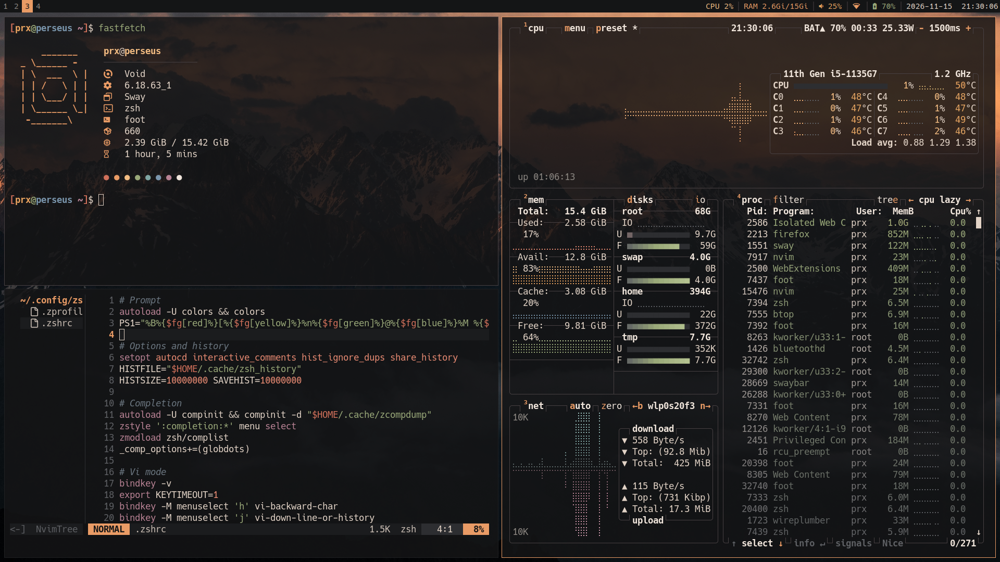

# voidfiles

My Void Linux + sway setup: a quiet desktop for writing code without distractions.



| | |
|---|---|
| **OS** | Void Linux (glibc, runit) |
| **WM** | sway |
| **Bar** | swaybar + i3blocks |
| **Terminal** | foot |
| **Shell** | zsh (vi mode, no framework) |
| **Launcher** | fuzzel |
| **Editor** | Neovim 0.12 (based on [nvim-lite](https://github.com/radleylewis/nvim-lite)) |
| **Files** | yazi |
| **Monitor** | btop |
| **PDF** | zathura |
| **Lock** | swaylock + swayidle |
| **Font** | Hack Nerd Font |

## Palette

| | hex | | hex |
|---|---|---|---|
| background | `#141516` | foreground | `#e2d3c6` |
| accent | `#e99b65` | selection | `#474042` |
| black | `#2d2e31` | bright black | `#5d5f63` |
| red | `#d0705a` | bright red | `#e88a72` |
| green | `#9aa979` | bright green | `#b4c290` |
| yellow | `#e9a35f` | bright yellow | `#f3bc82` |
| blue | `#7a96ad` | bright blue | `#97b1c6` |
| magenta | `#b88294` | bright magenta | `#d29db0` |
| cyan | `#7fa6a3` | bright cyan | `#9cc2bf` |
| white | `#c9bdb3` | bright white | `#f1e6dc` |

## What's here

```
~/.zshenv                 sets ZDOTDIR=~/.config/zsh
~/.config/
├── sway/config           keybinds, idle/lock, Ember Ridge window colours
├── i3blocks/             bar: cpu, ram, volume, wifi, battery, clock
├── swaylock/config
├── foot/foot.ini
├── fuzzel/fuzzel.ini
├── zsh/                  .zshrc, .zprofile
├── nvim/                 init.lua, colors/ember-ridge.lua, lualine theme
├── yazi/                 theme.toml, yazi.toml
├── btop/                 btop.conf, themes/ember-ridge.theme
├── fastfetch/config.jsonc
├── zathura/zathurarc
└── gtk-3.0/gtk.css
```

## Install

These dotfiles are a bare git repo whose work tree is `$HOME`.

```sh
sudo xbps-install -S git sway swaylock swayidle foot fuzzel i3blocks zsh \
    neovim yazi btop fastfetch zathura zathura-pdf-mupdf \
    pipewire wireplumber wl-clipboard clipman grim brightnessctl playerctl gnome-keyring

git clone --bare https://github.com/davidpirneci/voidfiles.git ~/.dotfiles
alias config='/usr/bin/git --git-dir=$HOME/.dotfiles/ --work-tree=$HOME'
config checkout            # if it complains, move the listed files out of the way and run it again
config config --local status.showUntrackedFiles no
```

You also need Hack Nerd Font, plus a wallpaper at `~/Pictures/wallpaper_1.png`.
Log out and back in, then start sway.

## Keys

| key | action |
|---|---|
| `Super + Enter` | terminal |
| `Super + d` | launcher |
| `Super + h/j/k/l` | focus |
| `Super + Shift + h/j/k/l` | move window |
| `Super + 1..0` | workspace |
| `Super + f` | fullscreen |
| `Super + r` | resize mode |
| `Super + Escape` | lock |
| `Super + Shift + q` | close window |
| `Print` | screenshot |
